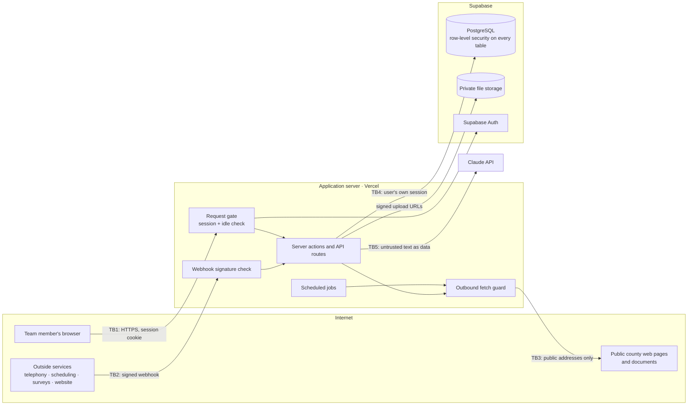

# Threat model: a claims-management platform that holds personal data

This repository is a threat model of a production web application I designed and run. It recovers surplus funds owed to former property owners and their heirs. The application was built with AI-assisted development (Claude Code). This document was drafted with Claude Code from the application's source and reviewed by me.

The source code is private. Everything here describes **controls that exist and are tested**. Open weaknesses are tracked privately and are added here once they are fixed. That is deliberate: a public list of unfixed problems helps attackers more than readers.

| File | What it covers |
| --- | --- |
| [README.md](README.md) | The system, what it protects, who might attack it, and where the trust boundaries are |
| [threats.md](threats.md) | Threats by STRIDE category, each with its mitigation and how it is verified |
| [ai-threats.md](ai-threats.md) | Threats specific to using a large language model (prompt injection, data sent to the model, cost abuse, over-trust) |
| [ssrf-case-study.md](ssrf-case-study.md) | A server-side request forgery flaw I found in a sibling project, and the guard both projects now share |

## The system

A small team uses the app to move each claim from a county's public surplus-funds list to payment: find the owner or heirs, search for liens, contact them, prepare and file documents, and collect a fee.

- **Front end and server:** Next.js on Vercel. All database access runs in server code; the browser never queries the database directly.
- **Database and sign-in:** Supabase (PostgreSQL with row-level security, Supabase Auth).
- **AI:** the Anthropic Claude API, for reading documents and drafting suggestions a person approves.
- **Outside services:** a telephony provider, a scheduling service, a survey service, an email sender, a shipping service and the business website. Each one calls the app through a signed webhook, or the app calls it from the server.
- **Scheduled jobs:** daily jobs that check public county web pages for new lists.

## What needs protecting

| Asset | Why it matters |
| --- | --- |
| Personal data of owners, heirs and relatives: names, mailing addresses, phone numbers, email addresses, deceased status, family relationships, ownership shares | It identifies people who are often elderly or grieving and who are owed money. That makes them targets for fraud. |
| Skip-trace results, call records and call transcripts | Detailed contact history; also sensitive under telemarketing law |
| Do-not-call records and opt-outs | Federal telemarketing rules require keeping these. Losing or altering them is a legal exposure. |
| Claim documents and filings | A forged or altered filing could redirect a payout. |
| Secrets: database service key, API keys, webhook secrets, a stored email-account token | Any one of them bypasses the controls below. |
| Spend on paid APIs (AI, skip tracing) | An abused endpoint turns directly into money lost. |

## Who might attack it

1. **Internet attacker with no account:** credential stuffing against sign-in, forged webhooks, abuse of any endpoint that fetches a URL.
2. **Fraudster targeting claimants:** wants owner and heir contact data and amounts owed, to reach them first or to impersonate the business.
3. **Malicious content:** a county document, web page or search result written to steer the AI, or a crafted spreadsheet or PDF aimed at the file parser.
4. **A signed-in team member making a mistake:** the most likely source of harm in a small team. Examples are a destructive reset, a call to someone on a do-not-call list, or an AI suggestion accepted without reading it.
5. **A compromised outside service:** a webhook sender whose secret leaks.

Out of scope: physical access, the cloud providers' own infrastructure, and the security of team members' own devices beyond sign-out behaviour.

## Data flow and trust boundaries

| Boundary | What crosses it | Main control |
| --- | --- | --- |
| TB1 browser → server | Every page load, form submission and server action | Session verified on every request; idle sign-out; row-level security behind it |
| TB2 outside service → server | Webhook events | HMAC signature with a constant-time compare, size limits, de-duplication, fail-closed when a secret is missing |
| TB3 server → internet | Fetches of county pages and lists | Address guard: public IPs only, connection pinned to the checked address, every redirect re-checked |
| TB4 server → database | Queries | Queries run as the signed-in user, so the database's own policies decide; the service key is confined to signed jobs |
| TB5 server → AI | Document and web text | Content passed as material rather than instructions, output schema-checked, a person approves every result |

## Design decisions that carry the most weight

1. **The database is the real security boundary.** Every table (193 of them) has row-level security. Each policy checks membership in the team through a single privileged helper function, and that function runs with an empty search path so it can't be hijacked. The request gate in front is a convenience, not the defence.
2. **Law is enforced in the database, not only on screen.** One database function decides whether a call may be dialled: do-not-call lists, permitted hours, daily caps, and whether the person is deceased. The screen only mirrors that rule, so a bug in the interface can't place an illegal call.
3. **Records that the law cares about are append-only.** Do-not-call checks and call attempts can't be changed or deleted, and they are kept for five years.
4. **AI suggests; people decide.** Nothing the model returns is saved as fact until a person approves it.
5. **Wiping out work asks for the password again.** Changing the password and resetting the call-script workspace both re-check the current password, and the reset keeps a copy of what it replaced so it can be brought back.

## Method

- STRIDE per trust boundary, applied to the data-flow diagram above.
- Each mitigation names how it's verified. The application has about 13,000 automated tests, including 91 database tests that check what an anonymous user, an outsider and each role can and can't do.
- Process: reviewed when a new outside service, a new kind of personal data or a new AI feature is added.

## Reporting a problem

If you believe you have found a vulnerability in something described here, please open a GitHub issue that says only that you have a report, and I will arrange a private channel. Please don't post details publicly.
